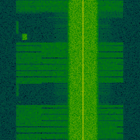
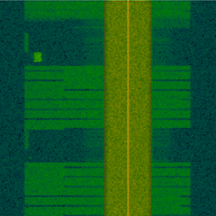

# 🛰️ yolo-jamming-detection

A YOLOv8-based object detection pipeline for identifying **jamming signals** using custom datasets.

---

## 🏷️ Labeling Images

Use [Label Studio](https://labelstud.io/) to label your images using the class name `JAM`.

After labeling, make sure to **export the annotations in the correct YOLO format**.

You should end up with:

```
custom_data/
├── images/         # Your input images
├── labels/         # YOLO-format `.txt` files for each image
├── classes.txt     # List of class names (should contain "JAM")
```

Ensure these files are correctly placed under `custom_data/` before training.

### Steps:
1. **Download and install Label Studio**:
   ```bash
   pip install label-studio
   ```

2. **Start Label Studio**:
   ```bash
   label-studio
   ```

3. Create a new project with **Object Detection (YOLO)** setup.

4. Upload your images from the dataset folder where you have signal screenshots .

5. Use bounding boxes to label jamming signals in the images.

6. Once labeling is complete:
   - Go to **Export**
   - Choose **YOLO Format**
   - Export the data

7. After export, you should have the following structure:
```
custom_data/
├── images/         # Your input images
├── labels/         # YOLO-format `.txt` files for each image
├── classes.txt     # List of class names (e.g., "JAM")
```

### 📸 Before and After Manual Annotation

Below is a comparison showing a sample image before and after annotation with the class `JAM` using Label Studio:

| **Before Annotation**     | **After Annotation**      |
|---------------------------|----------------------------|
|  |   |


---


#
## 📁 Initial Files & Structure

```
yolo-jamming-detection/
├── predict.py
├── prepare_and_train.py
├── train_val_split.py
├── custom_data/
│   ├── images/
│   ├── labels/
│   └── classes.txt
```

---

## ⚙️ Steps to Use

### 1. Split Dataset
Run the dataset split script:

```bash
python train_val_split.py --datapath="custom_data" --train_pct=0.9
```

This creates:
```
data/
├── train/
│   ├── images/
│   └── labels/
├── validation/
│   ├── images/
│   └── labels/
```

---

### 2. Merge Into `custom_data`

Copy `train/` and `validation/` into `custom_data/`, so it becomes:

```
custom_data/
├── images/
├── labels/
├── classes.txt
├── train/
└── validation/
```

---

### 3. Create `data.yaml`

Already included in this repo:

```yaml
path: custom_data
train: train/images
val: validation/images
nc: 1
names:
- JAM
```

---

### 4. Fix Runtime Warning (if needed)

If you get OpenMP-related issues, set the following:

```bash
set KMP_DUPLICATE_LIB_OK=TRUE  # (on Windows)
```

---

### 5. Train the Model

```bash
yolo detect train model=yolov8n.pt data=data.yaml epochs=60 imgsz=240

---

### 6. Run Predictions

```bash
python predict.py
```

- Lists available images from `custom_data/images`
- Lets you select one or more
- Displays detections
- Optionally saves results to `custom_data/Result/`

---

## ✅ Notes
- Make sure `ultralytics` is installed: `pip install ultralytics`
- Place all your `.jpg`/`.png` files in `custom_data/images/`
- Labels should follow YOLO format and be in `custom_data/labels/`


---


